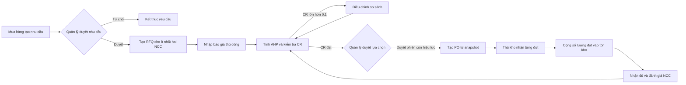
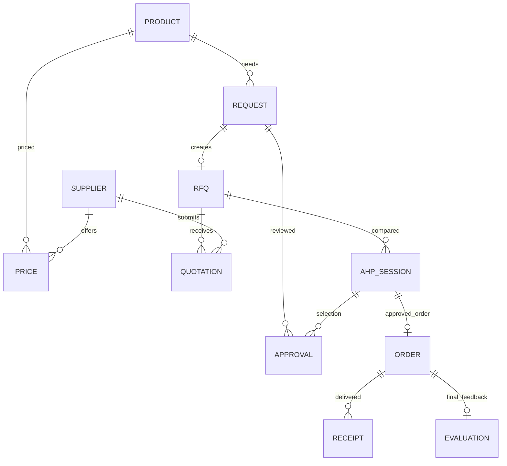

# Luồng và dữ liệu của giai đoạn nghiệp vụ

Sơ đồ mô tả bản đã triển khai. API kiểm tra quyền, trạng thái, hạn báo giá và CR trong transaction; giao diện chỉ hỗ trợ thao tác.

Database dùng các bảng PostgreSQL có khóa chính `id` và nội dung JSONB. Khóa ngoại cho quan hệ nghiệp vụ, chỉ mục unique cho SKU, email, giá NCC–mặt hàng, RFQ–yêu cầu, báo giá NCC–RFQ, PO–RFQ, khóa chống nhập lặp và đánh giá–PO. Quan hệ danh sách nhà cung cấp trong RFQ được kiểm tra ở service.

Mỗi lần tính AHP lưu bản chụp báo giá và dữ liệu tiêu chí. Sửa báo giá làm phiên trước mất hiệu lực; PO luôn đọc bản chụp đã duyệt. Một yêu cầu có tối đa một RFQ, một RFQ có tối đa một PO. Phiếu nhập retry cùng khóa và nội dung không cộng tồn lại; cùng khóa nhưng nội dung khác bị từ chối. Chỉ có một đánh giá cuối cùng khi PO đã nhận đủ.
