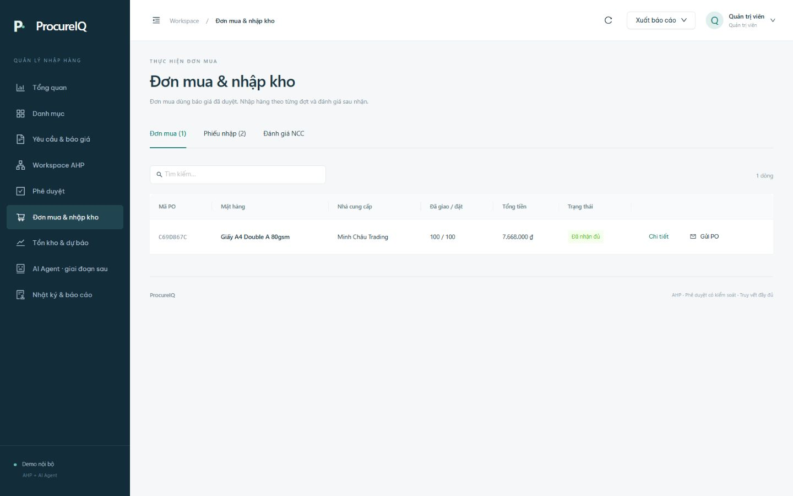

# Demo thủ công — 11/10/2026

Đã chạy trên Chrome với API local và dữ liệu PGlite lưu trên đĩa. Các thao tác đều dùng dữ liệu mô phỏng; không gửi email hay đặt mua ngoài hệ thống.

1. Đăng nhập admin demo; thêm mặt hàng `DEMO-KT-01` — Sổ ghi chép kiểm thử.
2. Tạo nhu cầu giấy A4, số lượng 100 ram, mã `277EE11D`. Duyệt nhu cầu với nhận xét “Demo: nhu cầu hợp lệ”.
3. RFQ `4805B184`, chỉ mời An Phát và Minh Châu. Dropdown báo giá chỉ hiện đúng hai NCC được mời.
4. Nhập An Phát: 68.000 VND, VAT 8%, giao 3 ngày, chất lượng 94; Minh Châu: 71.000 VND, VAT 8%, giao 2 ngày, chất lượng 96. Cả hai báo giá có hạn 10/11/2026.
5. Phiên AHP `80025A1D`, ma trận 4 tiêu chí đồng đều: trọng số 25% mỗi tiêu chí, lambda=4, CI=CR=0. Minh Châu 52,35%; An Phát 47,65%. Monte Carlo 1.000 lượt, seed42: Minh Châu đứng đầu 93,4%, An Phát 6,6%.
6. Gửi và duyệt điểm thứ hai `852B20A4`. Nút tạo PO chỉ được bật sau khi duyệt.
7. PO `C69D867C`, Minh Châu, 100 ram, tổng 7.668.000 VND gồm VAT.
8. Nhập hai đợt: 40 ram và 60 ram, đều đạt yêu cầu. PO chuyển “Nhận một phần” → “Đã nhận đủ”. Tồn giấy tăng 120 → 220 ram.
9. Đánh giá chất lượng 95, dịch vụ 90, nhận xét “Demo: giao đủ hai đợt, chất lượng tốt”.
10. Thử tạo SKU trùng `DEMO-KT-01`: backend từ chối; tên mặt hàng và mức tối thiểu 17 vẫn được giữ trong form. Hủy bản nháp, không thêm bản ghi trùng.

Không sửa ngày hệ thống và không giả lập phản hồi người dùng thật. Báo giá demo sẽ hết hạn theo ngày đã nhập; để thử luồng mới sau ngày này cần báo giá mới còn hiệu lực.

