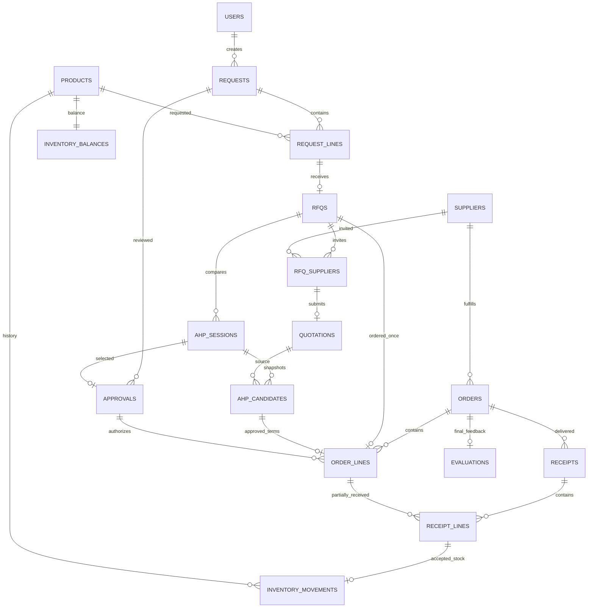

# Thiết kế CSDL QuocViet cho nghiệp vụ nhập hàng và AHP

Ngày: 11/10/2026. Phiên bản 2.

Trạng thái: phiên bản 1 được người dùng duyệt ngày 11/10/2026 và đã triển khai một phần (lược đồ SQL, repository, migration từ JSON). Phiên bản 2 là kết quả rà soát lại spec đối chiếu với code đã viết; các thay đổi mang mã R1–R23, liệt kê ở mục 12. Người dùng duyệt phiên bản 2 ngày 11/10/2026. Tình trạng cài đặt từng mục nằm ở cuối mục 12.

## 1. Mục tiêu và hiện trạng đã kiểm tra

Tạo nền dữ liệu có kiểu rõ ràng, ràng buộc quan hệ, chứng từ có chi tiết, tồn kho truy vết được, migration có phiên bản và truy vấn có thể kiểm chứng hiệu năng. Tiếp tục dùng PostgreSQL 18 đang cài trên máy và database `QuocViet`, cổng 5433.

Kiểm tra trực tiếp bằng transaction chỉ đọc (lần 1): 17 bảng hiện tại trong `public`, 14 khóa ngoại, một tài khoản quản trị và không có bản ghi nghiệp vụ. Phần lớn dữ liệu nằm trong cột `data JSONB`. Backend đọc toàn bảng rồi lọc trong JavaScript và dùng một khóa toàn cục cho mọi transaction.

Hiện trạng code khi rà soát lần 2 (nhánh `feat/normalized-db`, commit `5d7fdd4`): đã có `apps/api/migrations/001_core.sql` (25 bảng), `apps/api/src/database/*` và migration từ JSON. Trong worktree đang làm dở của nhánh đó, bộ kiểm thử API chạy 84 bài, 61 đạt; 23 bài không đạt đều thuộc `legacy-semantics.test.ts`, một file chưa commit, là kiểm thử viết trước cho phần "từ chối chuỗi nghiệp vụ cũ sai" chưa được cài đặt. `001_core.sql` chưa được áp dụng vào QuocViet thật.

Nguồn nghiệp vụ: kế hoạch Word của người dùng, `docs/design.md`, `docs/core-flow.md`, code API hiện hành. Quy trình: yêu cầu mua → duyệt nhu cầu → RFQ → báo giá → AHP → duyệt NCC → PO → nhận hàng từng đợt → đánh giá NCC. Những mục phân công, lịch học kỳ và yêu cầu giảng viên trong Word là bối cảnh, không phải lệnh thao tác máy hoặc gửi thông tin.

Giữ yêu cầu đã thống nhất: làm từng phần từ dễ đến khó; chưa bật AI Agent; chưa nâng cấp giao diện; CSDL thật không chứa dữ liệu mô phỏng. Tài khoản quản trị và mật khẩu băm hiện có phải được giữ nguyên.

## 2. Lựa chọn thiết kế

**Chuẩn hóa nghiệp vụ, giữ JSONB cho cấu trúc AHP phức hợp.** Sản phẩm, NCC, chứng từ, số lượng, tiền, trạng thái, phê duyệt và quan hệ nằm trong cột có kiểu và bảng liên kết. Cây tiêu chí, ma trận, kết quả Monte Carlo và độ nhạy được lưu JSONB có kiểm tra hình dạng.

Hai phương án khác đã cân nhắc và loại:

- Giữ bảng JSONB và bổ sung cột generated/check/index: chuyển đổi ít nhưng vẫn khó kiểm soát dữ liệu chi tiết, tồn kho và truy vấn báo cáo.
- Xây mô hình ERP nhiều công ty/kho, kế toán, hợp đồng và công nợ: quá rộng so với kế hoạch và chưa có yêu cầu thực tế.

Người dùng đã xác nhận cần hỗ trợ nhiều mặt hàng. CSDL có bảng đầu chứng từ–chi tiết, cho phép nhiều dòng trên yêu cầu mua, PO và phiếu nhập. API và giao diện hiện tại vẫn tạo một dòng; thao tác nhiều dòng đầu-cuối là đợt web tiếp theo. Không đặt UNIQUE lên request_id/order_id/receipt_id ở bảng chi tiết làm vô tình giới hạn một dòng.

Giả định còn lại: một công ty, một kho; đơn vị của mỗi sản phẩm cố định; số lượng nguyên; tiền VND; VAT tối đa hai chữ số thập phân.

Không thêm kế toán, xuất kho, trả hàng, nhiều kho, chuyển đổi đơn vị, cổng NCC hay thuật toán AHP mới. Sổ kho ghi tồn đầu và nhập hàng đạt chất lượng; chức năng xuất/điều chỉnh cần thiết kế riêng khi có yêu cầu.

## 3. Quy ước chung

- Schema nghiệp vụ `procurement`; bảng cũ được giữ trong `legacy_json_v1` sau chuyển đổi thành công. Repository luôn dùng tên schema đầy đủ, không phụ thuộc `search_path`.
- ID lưu `text` có kiểm tra độ dài, giữ nguyên ID hiện có như `u-admin` và ID demo; bản ghi mới dùng UUID do backend sinh.
- Cột dùng `snake_case`; API tiếp tục JSON `camelCase`. Mỗi thực thể có `created_at timestamptz`, cột `updated_at` khi thực thể được sửa. Thời điểm API trả ISO UTC; hạn báo giá dùng `date`.
- **Ngày nghiệp vụ (R10).** Mọi so sánh theo ngày lịch (báo giá còn hạn, gộp chi tiêu theo tháng) dùng múi giờ nghiệp vụ `BUSINESS_TIMEZONE`, mặc định `Asia/Ho_Chi_Minh`, không dùng ngày UTC. Backend là nguồn duy nhất của "hôm nay": bootstrap trả `businessDate`, web không tự tính từ đồng hồ trình duyệt. Báo giá có hạn ngày D còn hiệu lực đến hết ngày D theo giờ Việt Nam. Đồng hồ của service được tiêm vào để kiểm thử.
- Số lượng dùng `bigint`. Số lượng yêu cầu/báo giá tối đa 10.000.000; đơn giá tối đa 10.000.000.000 VND.
- **Trần cho số tồn (R8).** Tồn đầu và tồn tối thiểu tối đa 1.000.000.000, kiểm tra ở cả validation API và CHECK. Số dư kho tối đa `Number.MAX_SAFE_INTEGER`; phiếu nhập làm vượt trần bị từ chối với thông báo rõ.
- Đơn giá VND dùng `numeric` với CHECK giá trị nguyên; VAT dùng `numeric` với CHECK tối đa hai chữ số thập phân và khoảng 0–100. Không đặt typmod scale vì PostgreSQL sẽ tự làm tròn trước khi CHECK: 1,5 VND và VAT 0,001 phải bị từ chối. Tính tiền bằng số nguyên chính xác, làm tròn một lần ở cuối mỗi dòng như `money.ts`.
- Điểm chất lượng/dịch vụ/uy tín dùng `numeric` không scale cố định. Điểm dẫn xuất có thể bằng 0; điểm người dùng nhập là 1–100. Kết quả AHP dùng `double precision` hữu hạn, CR không âm.
- Dữ liệu bắt buộc có `NOT NULL` và `CHECK` đồng thời. Trạng thái và vai trò dùng `text CHECK`.
- Mặc định FK `ON DELETE RESTRICT`. Danh mục chưa được tham chiếu vẫn có thể xóa; dữ liệu đã dùng được bảo vệ. NCC và tài khoản đã dùng được ngừng bằng `active=false`, không xóa.
- **Một nguồn dữ liệu cho mỗi trường.** API dựng lại đối tượng từ cột/bảng quan hệ; không giữ bản JSONB tổng chứa toàn thực thể. Ba ngoại lệ có kiểm soát, ngoài ra không thêm:
  1. *Khóa dòng dõi lặp lại* (ví dụ `rfqs.request_id/product_id`, `ahp_candidates.rfq_id`, `order_lines.supplier_id`, `receipt_lines.product_id`): chỉ tồn tại để FK ghép bắt buộc chuỗi chứng từ khớp nhau; FK bảo đảm chúng không lệch khỏi nguồn.
  2. *Số dẫn xuất được lưu* (số dư kho, số đã nhận/đạt của dòng PO, trạng thái PO): mỗi số có đúng một nơi ghi là trigger trong CSDL (mục 5). Service và runtime role không ghi các cột này (R2).
  3. *`receipts.input_payload`*: bản gốc của yêu cầu để tra cứu; không dùng để tính toán hay so sánh retry (R21).
- **Ba loại bảng theo khả năng sửa (R4).** Mỗi bảng thuộc đúng một loại, và loại đó được bảo đảm bằng trigger, không chỉ bằng quy ước của service:
  - *Chỉ thêm* (cấm UPDATE, DELETE, TRUNCATE): `request_lines`, `rfq_suppliers`, `ahp_candidates`, `receipts`, `receipt_lines`, `inventory_movements`, `evaluations`, `audit`, `agent_steps`, `schema_migrations`.
  - *Chỉ đổi vòng đời*: `requests`, `ahp_sessions`, `approvals`, `orders`, `order_lines`, `rfqs`. Chỉ các cột trạng thái/bộ đếm nêu ở mục 4 được đổi, và chỉ theo bảng chuyển trạng thái ở mục 6.
  - *Sửa được*: `users`, `products`, `suppliers`, `prices`, `quotations`, `outbox`, `agent_runs`, `history`.

## 4. Bảng và trách nhiệm

Có 25 bảng, trong đó hai bảng Agent giữ tương thích nhưng không được bật, một bảng dành cho migration.

| Bảng | Dữ liệu chính | Khóa và ràng buộc nổi bật |
|---|---|---|
| `users` | name, email, role, password_hash, demo, active | email không phân biệt hoa thường unique; 5 vai trò; `active` mặc định true (R18) |
| `products` | sku, name, unit, min_stock, opening_stock, created_by_user_id | SKU unique; `unit`, `opening_stock`, `created_by_user_id` bất biến sau khi tạo (R2, R14); không lưu stock |
| `suppliers` | name, email, phone, reputation, active | uy tín 1–100; email không bắt buộc unique |
| `prices` | product_id, supplier_id, unit_price, delivery_days, quality_score | unique cặp NCC–sản phẩm |
| `requests` | reason, status, created_by_user_id, actor_kind, run_id | pending/approved/rejected; UNIQUE(id,status) để RFQ tham chiếu trạng thái (R3) |
| `request_lines` | request_id, line_no, product_id, quantity | unique(request_id,line_no); chỉ thêm (R4) |
| `rfqs` | request_line_id, request_id, product_id, request_status, status, run_id | unique request_line_id; `request_status` là hằng `'approved'` và FK ghép (request_id, request_status) → requests(id, status) (R3); status open/closed (R16) |
| `rfq_suppliers` | rfq_id, supplier_id | PK ghép; chỉ thêm |
| `quotations` | rfq_id, supplier_id, quantity, unit_price, vat, currency, delivery_days, quality_score, valid_until, source | unique(rfq_id,supplier_id); FK ghép đến rfq_suppliers |
| `ahp_sessions` | rfq_id, status, cr, consistent, input_artifact, result_artifact, run_id | draft/pending_approval/approved/rejected/stale; tối đa một phiên pending_approval hoặc approved cho mỗi RFQ (R1); không còn cột revision (R15) |
| `ahp_candidates` | session_id, rfq_id, quotation_id, supplier_id, tên NCC chụp, điều khoản báo giá chụp, criterion_inputs | unique(session_id,supplier_id); chỉ thêm |
| `approvals` | gate, request_id, rfq_id, session_id, status, selected_supplier_id, proposal, comment, decided_by, decided_at, run_id | unique request tại gate1; unique session tại gate2; UNIQUE(id, session_id, selected_supplier_id, status) để dòng PO tham chiếu (R3) |
| `orders` | supplier_id, status, sent_at, run_id | status do trigger đặt từ bộ đếm dòng (R2) |
| `order_lines` | order_id, line_no, rfq_id, session_id, candidate_id, approval_id, approval_status, supplier_id, product_id, product_sku, product_name, unit, quantity, unit_price, vat, delivery_days, received_quantity, accepted_quantity | unique(order_id,line_no); unique rfq_id; `approval_status` là hằng `'approved'` và FK ghép (approval_id, session_id, supplier_id, approval_status) → approvals (R3); chụp sku/tên/đơn vị (R14); 0≤accepted≤received≤quantity; bộ đếm do trigger ghi (R2) |
| `receipts` | order_id, idempotency_key, received_at, notes, created_by, request_fingerprint, input_payload | idempotency_key unique; chỉ thêm |
| `receipt_lines` | receipt_id, order_id, order_line_id, product_id, quantity, accepted_quantity | unique(receipt_id,order_line_id); FK ghép bảo đảm dòng thuộc đúng PO; chỉ thêm |
| `inventory_balances` | product_id, quantity, updated_at | PK product_id; chỉ trigger ghi |
| `inventory_movements` | product_id, delta, kind, receipt_line_id, created_by_user_id, actor_kind | OPENING/RECEIPT; delta dương; unique receipt_line_id; tối đa một OPENING/sản phẩm; chỉ trigger ghi (R2); actor là user hoặc system (R17) |
| `evaluations` | order_id, supplier_id, product_id, các điểm, notes, created_by | unique order_id; chỉ thêm |
| `history` | product_id, supplier_id, month, quantity, unit_price, on_time, quality_score, synthetic | tháng lưu ngày đầu tháng; không ảnh hưởng sổ kho |
| `audit` | actor_kind, actor_user_id, actor_name, actor_role, action, entity_type, entity_id, detail | chỉ thêm; `entity_type` bắt buộc khi có `entity_id` (R12) |
| `outbox` | message_key, type, rfq_id, order_id, supplier_id, recipient, subject, text_body, status | message_key unique; ghi trong transaction nghiệp vụ |
| `agent_runs` | binding product/request/rfq/session/order, status, stage, created_by, quantity, tokens_used, step_count, demo, error, usage_ids | FK thật; không chạy Agent |
| `agent_steps` | run_id, tool, stage, status, detail | chỉ thêm |
| `schema_migrations` | version, name, checksum, applied_at | chỉ thêm; mỗi phiên bản một dòng |

**Tương thích API.** Trường một dòng cũ được dựng từ JOIN: `products.stock` lấy từ `inventory_balances`; `rfqs.quantity` lấy từ dòng nhu cầu; `orders` trả product/session/rfq khi có đúng một dòng; `ahpSessions.revision` và `approvals.revision` (gate2) trả hằng số 1 (R15). Gặp chứng từ nhiều dòng trước khi có API mới thì trả lỗi nghiệp vụ rõ ràng, không âm thầm lấy dòng đầu.

**Tổng PO** tính từ thành tiền các dòng, làm tròn VND cuối mỗi dòng như `money.ts`; không lưu tổng độc lập.

**Chụp thông tin sản phẩm vào PO (R14).** Dòng PO chụp `product_sku`, `product_name`, `unit` tại thời điểm tạo, giống cách candidate chụp tên NCC. Đổi tên/SKU sản phẩm về sau không làm đổi nội dung PO đã phát hành. `unit` của sản phẩm bất biến; sửa đơn vị sai bằng cách xóa sản phẩm chưa dùng rồi tạo lại.

**Hai điểm duyệt được bảo đảm trong CSDL (R3).** FK không kiểm tra được giá trị của dòng khác, trừ khi giá trị đó nằm trong khóa được tham chiếu. Vì vậy:

- `rfqs` mang cột hằng `request_status='approved'` và tham chiếu `requests(id, status)`. Không thể chèn RFQ cho nhu cầu chưa duyệt, và nhu cầu đã có RFQ không thể đổi trạng thái.
- `order_lines` mang `approval_id` và cột hằng `approval_status='approved'`, tham chiếu `approvals(id, session_id, selected_supplier_id, status)`. Không thể chèn dòng PO nếu gate2 của đúng phiên đó chưa duyệt đúng NCC đó, và quyết định đã có PO không thể bị sửa.

Service vẫn kiểm tra trước để trả thông báo dễ hiểu; FK là lớp bảo đảm cuối cùng.

**Phạm vi một RFQ.** Mỗi RFQ và phiên AHP xét một sản phẩm. Nhu cầu nhiều dòng tạo nhiều RFQ. Một PO có thể chứa các dòng RFQ đã duyệt cho cùng NCC; chức năng gom dòng chưa mở trong API hiện tại. Không cộng điểm AHP giữa nhiều sản phẩm.

Sơ đồ các quan hệ chính:

## 5. Sổ kho và số dẫn xuất

**Nguyên tắc (R2).** Số dư kho, bộ đếm đã nhận/đạt của dòng PO và trạng thái PO đều suy ra được từ chứng từ gốc. Mỗi số có một nơi ghi duy nhất là trigger chạy khi chứng từ gốc được chèn. Service không tính và không ghi các số này; runtime role không có quyền INSERT vào `inventory_movements`, không có quyền UPDATE trên `inventory_balances`, `order_lines`, và chỉ được UPDATE cột `sent_at`, `updated_at` của `orders`. Độc lập với phân quyền, trigger bảo vệ kiểm tra `pg_trigger_depth()`: câu lệnh ghi sổ kho, số dư hoặc bộ đếm đến trực tiếp từ client bị từ chối với mọi role, kể cả superuser; chỉ câu lệnh phát ra từ bên trong trigger khác mới được nhận. Trạng thái PO được tính lại từ các dòng ở mỗi lần ghi, nên giá trị do client gửi bị bỏ qua.

Lý do thay đổi so với phiên bản 1: phiên bản 1 để service gọi riêng một bước ghi sổ sau khi chèn phiếu nhận, và để service ghi bộ đếm bằng giá trị tuyệt đối đã đọc trước đó. Bước ghi sổ có thể bị quên mà đối soát không phát hiện được (xem "Chuyển dữ liệu cũ" bên dưới). Ghi giá trị tuyệt đối sẽ mất cập nhật ngay khi một đường ghi thiếu khóa, và CHECK không bắt được vì giá trị ghi vào vẫn hợp lệ.

**Tồn đầu.** `products.opening_stock` là thuộc tính của sản phẩm, đặt một lần khi tạo. Trigger sau INSERT `products` tạo số dư 0; nếu `opening_stock > 0` thì chèn một biến động OPENING, người thực hiện lấy từ `products.created_by_user_id` (NULL nghĩa là hệ thống: seed hoặc dữ liệu chuyển đổi). API vẫn nhận `stock` khi tạo sản phẩm và ánh xạ sang `opening_stock`. Vì không có đường nào khác chèn OPENING, không thể bơm tồn đầu cho sản phẩm đã tồn tại.

**Nhập hàng.** Một trigger sau INSERT `receipt_lines` làm ba việc theo thứ tự cố định:

1. Cộng tương đối vào bộ đếm của dòng PO: `received_quantity = received_quantity + NEW.quantity`, `accepted_quantity = accepted_quantity + NEW.accepted_quantity`. CHECK `received_quantity <= quantity` từ chối nhận vượt, kể cả khi hai phiếu đến đồng thời.
2. Đặt `orders.status`: `received` khi mọi dòng đã nhận đủ, ngược lại `partially_received`.
3. Nếu số đạt lớn hơn 0, chèn biến động RECEIPT với người thực hiện là `receipts.created_by`. Trigger của sổ kho cộng số dư.

Phần đạt bằng 0 không sinh biến động nhưng phiếu nhận vẫn được giữ. FK ghép (receipt_line_id, product_id, delta) → receipt_lines(id, product_id, accepted_quantity) bảo đảm biến động khớp đúng dòng nhận.

Service khi nhận hàng chỉ còn: khóa PO, kiểm tra duyệt và idempotency, chèn `receipts` rồi `receipt_lines`. Dòng nhận được chèn theo thứ tự (product_id, order_line_id) để hai PO nhiều dòng không khóa số dư theo thứ tự ngược nhau.

**Quyền của trigger.** Các function ghi số dẫn xuất là `SECURITY DEFINER`, thuộc owner chuyên dụng, `search_path` cố định (`pg_catalog, procurement, pg_temp`), dùng tên schema đầy đủ, đã thu hồi EXECUTE của PUBLIC. Database owner vẫn can thiệp phục hồi được; vì vậy runtime không bao giờ là owner.

**Xóa sản phẩm.** Trigger trước DELETE `products` chỉ xóa số dư khi quantity=0 và không có biến động. Sản phẩm tạo với tồn đầu dương đã có biến động nên không xóa được. FK của chứng từ chặn xóa sản phẩm đã dùng.

**Chuyển dữ liệu cũ (thay đổi so với phiên bản 1).** Phiên bản 1 ghi OPENING bằng đúng tồn hiện tại và không phát lại phiếu nhập cũ. Hệ quả là phiếu cũ không có biến động tương ứng, nên không thể viết câu đối soát "mọi dòng nhận có số đạt đều có biến động": câu đó sẽ báo sai trên dữ liệu cũ, còn bỏ câu đó thì không phát hiện được phiếu mới bị thiếu ghi sổ. Phiên bản 2 đi cùng một đường cho dữ liệu cũ và mới:

- Sản phẩm cũ được chèn với `opening_stock = tồn hiện tại − tổng số đạt của các phiếu nhận cũ`. Kết quả âm nghĩa là dữ liệu cũ mâu thuẫn: dừng migration và báo ID sản phẩm.
- PO cũ được chèn với bộ đếm 0. Phiếu nhận cũ được chèn bình thường; trigger dựng lại bộ đếm, trạng thái và biến động.
- Sau khi chèn xong, so sánh bộ đếm, trạng thái PO và số dư với giá trị trong dữ liệu cũ. Lệch ở bất kỳ đâu thì rollback toàn bộ và báo bảng/ID.

Đây không phải cộng hai lần: tồn đầu đã trừ phần nhập, nên tồn đầu cộng các phiếu nhập bằng đúng tồn hiện tại. Sổ kho sau chuyển đổi có đủ lịch sử nhập.

**Đối soát.** Bốn câu truy vấn phải trả về rỗng, áp dụng cho mọi dữ liệu không phân biệt cũ mới:

1. Số dư khác tổng delta của biến động.
2. Bộ đếm dòng PO khác tổng dòng nhận.
3. Trạng thái PO không khớp bộ đếm.
4. Dòng nhận có số đạt dương mà không có biến động, hoặc biến động RECEIPT không có dòng nhận.

Đối soát sai thì báo lỗi để kiểm tra nguồn; không tự sửa số dư.

**Idempotency (R9, R21).** `request_fingerprint` là SHA-256 của payload đã chuẩn hóa: thời điểm đổi về UTC, các dòng sắp theo order_line_id, khóa JSON sắp thứ tự. So sánh retry dùng fingerprint. `input_payload` giữ nguyên bản người dùng gửi (kể cả offset múi giờ gốc) chỉ để tra cứu. Retry cùng khóa và cùng fingerprint trả phiếu cũ; khác fingerprint trả 409. Service phải kiểm tra lại khóa idempotency *sau khi* đã khóa PO, vì yêu cầu trùng có thể commit trong lúc chờ khóa. Nếu vẫn gặp lỗi unique trên `idempotency_key`, service đọc lại phiếu trong transaction mới và áp dụng cùng quy tắc so sánh, không trả lỗi unique chung chung.

## 6. Phê duyệt, bản chụp AHP và đồng thời

Hai điểm duyệt giữ nguyên. Service kiểm tra quyền admin/manager, trạng thái và đúng request/session. Buyer và Agent không được phê duyệt.

**Bảng chuyển trạng thái (R4).** Trigger từ chối mọi chuyển đổi ngoài bảng này. Trạng thái không có mũi tên đi ra là trạng thái cuối và cả dòng trở thành bất biến.

| Bảng | Chuyển đổi hợp lệ |
|---|---|
| `requests.status` | pending → approved, rejected |
| `approvals.status` | pending → approved, rejected, cancelled. Khi rời pending, `decided_by`, `decided_at`, `selected_supplier_id`, `comment` được ghi cùng lúc và không đổi nữa |
| `ahp_sessions.status` | draft → pending_approval, stale; pending_approval → approved, rejected, stale; approved → stale; rejected → stale |
| `rfqs.status` | open → closed |
| `orders.status` | ordered → partially_received → received (chỉ trigger ghi) |

**Quan hệ giữa quyết định và hiệu lực.** `approvals` là hồ sơ quyết định, không bị sửa sau khi quyết định. `ahp_sessions.status` là hiệu lực hiện tại của phiên. Vì vậy tồn tại hợp lệ trường hợp approval gate2 `approved` mà phiên đã `stale` (báo giá bị sửa sau khi duyệt). Điều kiện tạo PO luôn là phiên đang `approved`; quyết định `approved` riêng nó không đủ.

**Tối đa một phiên còn hiệu lực cho mỗi RFQ (R1).** Code hiện tại cho phép tính và trình duyệt phiên thứ hai trong khi phiên thứ nhất đã được duyệt; khi đó hai phiên cùng `approved` và người mua tự chọn phiên nào để lập PO, kể cả phiên chọn NCC mà quản lý đã thay bằng quyết định sau. Quy tắc mới:

- Unique index từng phần trên `ahp_sessions(rfq_id)` với điều kiện status là `pending_approval` hoặc `approved`.
- Khi gửi duyệt một phiên, trong cùng transaction dưới khóa RFQ: mọi phiên khác của RFQ đang `pending_approval` hoặc `approved` chuyển sang `stale`, approval đang pending của chúng chuyển sang `cancelled`. Đề xuất mới nhất thay đề xuất cũ. Hành vi này nhất quán với việc sửa báo giá vốn đã làm mất hiệu lực phiên cũ.
- Dữ liệu cũ vi phạm quy tắc này làm migration dừng và báo ID; không tự chọn phiên nào giữ lại.

**Bản chụp.** Đầu vào, điều khoản báo giá và kết quả AHP bất biến ngay khi phiên được tạo; chỉ status thay đổi. Điều chỉnh tiêu chí/ma trận tạo phiên mới (vì vậy không cần số revision, R15). Sửa báo giá trước khi có PO làm mọi phiên chưa stale của RFQ thành stale và hủy approval đang pending trong cùng transaction. Không sửa báo giá khi RFQ đã `closed`.

**Đóng RFQ (R16).** RFQ chuyển `closed` trong cùng transaction tạo dòng PO cho nó. Sửa/thêm báo giá và tính AHP yêu cầu RFQ đang `open`; điều này thay cho việc quét bảng orders. Câu đối soát thứ năm: RFQ `closed` khi và chỉ khi có dòng PO.

**Điều kiện theo từng bước.** Khi gửi duyệt và khi *chấp thuận* gate2: còn ít nhất hai candidate có NCC đang hoạt động và báo giá chụp chưa hết hạn; candidate được chọn phải thuộc nhóm đó. Từ chối không cần điều kiện này. Khi tạo PO: phiên đang `approved`, CR≤0,1, consistent=true; candidate được chọn thuộc phiên, NCC còn hoạt động, báo giá chụp còn hạn. Một NCC không được chọn hết hạn sau khi duyệt không chặn tạo PO. PO lấy điều khoản từ candidate, không đọc bảng giá hiện hành.

**Thứ tự khóa.** Mọi đường ghi lấy khóa theo một thứ tự toàn cục; lấy ngược thứ tự là lỗi. Thứ tự: `agent_runs` → `requests` → `rfqs` → `ahp_sessions` → `approvals` → `suppliers` (FOR SHARE, theo ID) → `orders` → `order_lines` (theo ID). Trigger khóa tiếp `order_lines` → `orders` → `inventory_balances` theo thứ tự chèn dòng nhận.

- Thao tác chỉ biết ID của bản ghi đứng sau (ví dụ quyết định theo approval ID) đọc bản ghi đó không khóa để tìm bản ghi đứng trước, lấy khóa theo thứ tự, rồi đọc lại và kiểm tra lại dưới khóa.
- Duyệt gate1 và tạo RFQ khóa request. Sửa/thêm báo giá, tính AHP, gửi duyệt, quyết định gate2 và tạo PO cùng khóa RFQ. Tính AHP giữ khóa RFQ từ lúc đọc báo giá đến khi lưu bản chụp, nên không có phiên dùng báo giá cũ lọt ngoài lần làm mất hiệu lực.
- Thao tác gắn với một Agent run (kể cả quyết định của người cho approval có run_id) khóa run trước tiên.
- Cập nhật `suppliers.active` chỉ khóa hàng NCC, không khóa ngược lên RFQ.
- Nhập hàng khóa PO rồi các dòng theo ID. Đánh giá NCC khóa PO và yêu cầu trạng thái `received`.
- Mọi chuyển trạng thái dùng UPDATE có điều kiện trên trạng thái cũ (`... WHERE id=$1 AND status=$2`) và kiểm tra đúng một dòng bị ảnh hưởng. Không ghi lại cả thực thể đã đọc trước đó.

Các helper khóa nằm tập trung một chỗ để thứ tự hiện rõ khi review. Chỉ gỡ khóa advisory toàn cục sau khi mọi đường ghi, gồm cả tool Agent đang tắt, đã đi qua giao thức này.

**Lỗi đồng thời (R9).** Transaction nghiệp vụ không gọi dịch vụ ngoài, nên chạy lại là an toàn.

| Tình huống | Mã PostgreSQL | Xử lý |
|---|---|---|
| Deadlock, lỗi tuần tự hóa | 40P01, 40001 | Tự chạy lại cả transaction tối đa 2 lần với độ trễ ngẫu nhiên ngắn; vẫn lỗi thì HTTP 503 |
| Hết thời gian chờ khóa | 55P03 | HTTP 503 kèm lời nhắc thử lại; không tự chạy lại |
| Trùng khóa nghiệp vụ | 23505 | HTTP 409; riêng `idempotency_key` xử lý theo mục 5 |
| Vi phạm FK, CHECK, trigger | 23503, 23514 | HTTP 409 với thông báo tiếng Việt an toàn; không lộ tên ràng buộc hay SQL |

AHP không tính trong SQL hoặc Agent. JSONB của AHP chỉ chứa cấu trúc đầu vào/kết quả đã qua schema validation.

## 7. Truy vấn và hiệu năng

Thay lọc toàn bảng trong đường ghi bằng truy vấn có điều kiện: user theo email khi đăng nhập; RFQ theo request_line; quotation theo RFQ/NCC; approval theo gate/session; order theo RFQ; receipt theo idempotency_key/order; evaluation/history theo NCC; phiên AHP theo RFQ. Mọi giá trị dùng parameter SQL; tên bảng/cột thuộc allowlist.

**Không truy vấn theo từng dòng (R6).** Repository hiện tại nạp dòng con bằng một truy vấn riêng cho mỗi bản ghi cha (request, RFQ, phiên AHP, PO, phiếu nhận); bootstrap liệt kê mọi bảng nên số truy vấn tăng theo số chứng từ. Yêu cầu: `list`/`find` của một bảng dùng số câu lệnh cố định (tối đa 3) bất kể số dòng, nạp dòng con theo lô bằng JOIN hoặc `= ANY($1)`. Kiểm thử đếm số câu lệnh với 1 và với 50 chứng từ và yêu cầu bằng nhau.

**Đọc không xếp hàng sau ghi (R6).** Trên PostgreSQL thật, transaction chỉ đọc (bootstrap, xác thực token, báo cáo) không đi qua hàng đợi tuần tự của service và không lấy khóa advisory. PGlite giữ hàng đợi vì chỉ có một kết nối.

**Một công thức, một nơi cài đặt (R7).** Hiện điểm hiệu suất NCC, dự báo trung bình trượt và tổng tiền đều có hai bản cài đặt (JavaScript và SQL). Điểm hiệu suất NCC là đầu vào tiêu chí "Uy tín" của AHP, nên hai bản lệch nhau sẽ làm dashboard và kết quả AHP mâu thuẫn. Quy định:

- Điểm hiệu suất NCC và dự báo: chỉ cài đặt bằng SQL (view hoặc truy vấn của repository). AHP, dashboard và Agent đều đọc từ đó. Giá trị đưa vào AHP được chụp vào `criterion_inputs`, nên phiên cũ không đổi.
- Tổng tiền: `money.ts` là chuẩn cho đường ghi; biểu thức SQL chỉ dùng cho tổng hợp. Một kiểm thử so sánh hai bên trên các trường hợp biên làm tròn (phần lẻ đúng 0,5 VND, VAT hai chữ số thập phân, giá trị sát trần).

**Tổng hợp vượt giới hạn số (R8).** Giá trị tồn kho và chi tiêu tháng là tổng không có trần. Khi tổng vượt `Number.MAX_SAFE_INTEGER`, API trả `null` cho đúng chỉ số đó kèm cờ cảnh báo; không ném lỗi làm hỏng toàn bộ bootstrap.

**Chi tiêu tháng (R22).** Chuỗi hiện cộng lịch sử (không có VAT) với PO (đã gồm VAT). Trả hai thành phần riêng (`historyValue`, `orderValue`) cùng tổng, và giao diện ghi rõ cơ sở tính.

Chỉ mục ngoài PK/UNIQUE: FK chưa được chỉ mục khác phủ; approvals pending theo created_at/id; requests và orders theo status/created_at/id; receipts theo order_id/received_at/id; history theo product_id/month và supplier_id/month; audit theo created_at/id và entity_type/entity_id; outbox pending theo created_at/id; agent_steps theo run_id/created_at/id.

Pool có giới hạn, lock timeout và statement timeout cấu hình được. Bootstrap đọc trong transaction chỉ đọc REPEATABLE READ. Hợp đồng bootstrap giữ nguyên và vẫn trả toàn bộ danh sách; chưa tuyên bố phù hợp hàng triệu bản ghi. Phân trang API/UI là đợt riêng.

Đo bằng EXPLAIN (ANALYZE, BUFFERS) trên database kiểm thử riêng có dữ liệu quy mô. Không hứa thời gian đáp ứng cố định trước khi đo.

**Nhật ký (R12).** Mỗi bản ghi audit có `entity_type` theo bảng ánh xạ cố định từ thao tác sang loại thực thể (product, supplier, price, request, approval, rfq, quotation, ahp_session, order, receipt, evaluation, agent_run). Sửa danh mục ghi `detail.changes` gồm giá trị trước và sau của các trường thay đổi, vì bảng giá tham khảo không có lịch sử riêng. Không bao giờ ghi mật khẩu, hash hay token vào audit.

**Thông tin đăng nhập (R18).** `password_hash` chỉ được đọc bởi truy vấn dành riêng cho đăng nhập; các truy vấn user khác không chọn cột này. Xác thực token từ chối tài khoản `active=false`.

## 8. Migration, phân quyền DB và phục hồi

**Hợp đồng của runner (R5).** Runner hiện tại chỉ chấp nhận đúng một phiên bản, trong khi đợt web đã cần migration tiếp theo. Quy định:

- Migration là danh sách file SQL đánh số liên tục `NNN_tên.sql`. Runner áp dụng các bản còn thiếu theo thứ tự, mỗi bản trong một transaction riêng, ghi một dòng `schema_migrations` cho mỗi bản.
- Trước khi áp dụng, runner xác minh checksum của mọi bản đã áp dụng. Checksum sai, thiếu bản ở giữa, hoặc DB có phiên bản mới hơn code đều là lỗi dừng, không sửa tự động.
- Runtime khởi động yêu cầu DB ở đúng phiên bản cuối mà code biết.
- Chuyển dữ liệu JSON cũ là một bước một lần gắn với bản 001, không phải cơ chế chung.
- Checksum tính trên nội dung đã bỏ BOM và đổi CRLF thành LF. Thêm `.gitattributes` với `*.sql text eol=lf` (máy này đang bật `core.autocrlf=true`).
- **Thời điểm đóng băng.** Một bản migration bị đóng băng kể từ khi được áp dụng vào QuocViet thật. Bản 001 đã nhận các thay đổi R1–R23 trước khi áp dụng và đóng băng từ ngày 11/10/2026; mọi thay đổi lược đồ tiếp theo là file `002_…` trở đi. Database PGlite cục bộ tạo bằng bản 001 trước ngày đó sẽ báo sai checksum; đó là dữ liệu demo, tạo lại bằng seed.

Trên PostgreSQL thật, runtime không chạy DDL; migration là lệnh quản trị riêng. Trên PGlite (demo, kiểm thử), mở database tự migrate.

**Sao lưu trước khi migrate (R5).** Trước mọi lần áp dụng migration vào database có dữ liệu:

- PostgreSQL thật: `pg_dump` định dạng custom vào `.data/backups/`, đã khôi phục thử vào database riêng.
- PGlite: khi thư mục dữ liệu chứa bảng JSON cũ hoặc phiên bản cũ hơn, sao chép nguyên thư mục sang `.data/backups/postgres-<thời điểm>` trước khi mở để migrate. Phiên bản 1 không có bước này, nên chạy code mới trên thư mục demo sẽ chuyển đổi tại chỗ mà không có đường lùi.

Quy trình áp dụng vào QuocViet:

1. Xây và kiểm thử trên database riêng cùng PostgreSQL 18, cộng PGlite để giữ demo/CI.
2. Sao lưu như trên; xác nhận restore và đối chiếu số lượng, hash admin bằng so sánh trong bộ nhớ, không in hash/mật khẩu.
3. Dừng API của dự án trong thời gian chuyển đổi; không dừng dịch vụ PostgreSQL của người dùng.
4. Lấy khóa advisory của migration, xác nhận đúng database/cổng và trạng thái trước chuyển đổi. Phát hiện dữ liệu mới thì bảo toàn toàn bộ hoặc dừng với báo cáo.
5. Trong transaction: tạo schema mới, chuyển dữ liệu theo mục 5, giữ nguyên ID/hash/thời điểm, đối soát, chuyển bảng JSON cũ sang `legacy_json_v1`, ghi phiên bản. Dữ liệu sai kiểu, sai FK, vi phạm quy tắc nghiệp vụ hoặc vượt giới hạn thì rollback toàn bộ và báo bảng/ID.
6. Tạo runtime role riêng, không superuser/createdb/createrole; owner/migrator tách khỏi runtime. Thông tin `postgres` hiện có chỉ dùng cho bước thiết lập một lần; giữ nguyên vai trò `postgres` và các database khác. Mật khẩu runtime sinh ngẫu nhiên, ghi vào cấu hình local có ACL, không đưa vào Git/log/chat.
7. Cập nhật `.env` bằng ghi file tạm rồi thay thế nguyên tử; giữ cấu hình cũ ở vị trí local được bảo vệ. Khởi động API mới; xác nhận health, đăng nhập admin, bootstrap trống.
8. Kiểm thử luồng nhập hàng trên database riêng. QuocViet thật tiếp tục trống về nghiệp vụ.

**Quyền của runtime role.** SELECT trên mọi bảng nghiệp vụ; không DDL; không TRUNCATE trên bất kỳ bảng nào; không truy cập `legacy_json_v1`. Quyền ghi theo loại bảng ở mục 3: bảng chỉ thêm chỉ có INSERT (riêng `inventory_movements` và `schema_migrations` không có cả INSERT); bảng vòng đời có INSERT và UPDATE trên đúng các cột trạng thái; `inventory_balances` và `order_lines` không có UPDATE. Trigger là lớp bảo vệ độc lập với quyền, vì kiểm thử PGlite chạy bằng superuser. Bảng chỉ thêm có thêm trigger mức câu lệnh chặn TRUNCATE, do TRUNCATE không kích hoạt trigger mức dòng (R4).

**Bảng cũ (R19).** `legacy_json_v1` chứa bản sao hash mật khẩu và dữ liệu sẽ ngày càng lệch so với schema mới. Giữ đến khi người dùng nghiệm thu chuyển đổi; sau đó xóa bằng lệnh quản trị riêng, có xác nhận và sau một bản sao lưu đã kiểm chứng. Không tự xóa trong đợt này và không giữ vô thời hạn.

**Rollback.** Khi chưa có giao dịch mới: dùng code/cấu hình trước chuyển đổi cùng bảng legacy hoặc bản dump đã kiểm chứng. Sau khi có giao dịch thật trên schema mới, không quay về bảng legacy vì sẽ mất giao dịch; sửa tiếp bằng migration mới hoặc phục hồi có đối soát.

Mở lại database đã migrate không chuyển dữ liệu lần nữa. Checksum khác, migration thiếu hoặc DB chưa thiết lập phải lỗi rõ ràng và không ghi một phần.

## 9. Thứ tự triển khai

Thứ tự thực tế đã khác phiên bản 1 (lược đồ đầy đủ được viết trước). Cập nhật theo tình trạng thật:

1. **Lược đồ SQL và kiểm thử ràng buộc.** Đã xong theo phiên bản 1 (commit `bfaa203`). Cần sửa lại theo phiên bản 2: xem cột "Ảnh hưởng" ở mục 12.
2. **Repository và migration từ JSON.** Đang dở (commit `5d7fdd4` cộng 23 kiểm thử chưa đạt). Hoàn tất sau khi bước 1 được sửa, vì đường chuyển dữ liệu cũ thay đổi theo mục 5.
3. **Truy vấn có chỉ mục, khóa theo phạm vi, gỡ khóa toàn cục.**
4. **Kiểm thử trên PostgreSQL thật:** tranh chấp, quyền runtime, kế hoạch truy vấn. CI có service PostgreSQL 18 và chạy bộ này với 0 bài bị bỏ qua (R13).
5. **Sao lưu, phân quyền, áp dụng vào QuocViet, bàn giao** ERD, từ điển dữ liệu, hướng dẫn sao lưu.

Mỗi phần có kiểm thử và commit riêng. Chỉ đổi CSDL thật sau khi toàn bộ phần liên quan vượt kiểm thử.

## 10. Tiêu chí nghiệm thu

Giữ từ phiên bản 1:

- PostgreSQL 18 thật và PGlite đều chạy luồng hiện tại; toàn bộ kiểm thử và build vẫn đạt.
- Migration từ JSON giữ nguyên ID, hash admin, dữ liệu mẫu demo, bản chụp và tổng tồn; chạy lại không nhân bản. Lỗi giữa migration thì rollback và không ghi phiên bản.
- SQL trực tiếp cũng từ chối số âm, NULL bắt buộc, trạng thái sai, FK sai, NCC không được mời, receipt/order khác nhau và trùng khóa nghiệp vụ.
- PO sai phiên/stale/hết hạn bị chặn; sửa bảng giá không đổi điều khoản PO; trigger không cho sửa bản chụp.
- Hai client gửi đồng thời: cùng receipt key chỉ cộng tồn một lần; khác key không vượt lượng PO; hai PO cùng sản phẩm không mất cập nhật; hai PO độc lập tiến triển đồng thời.
- Tranh chấp giữa sửa báo giá và lưu phiên AHP không để phiên dùng giá cũ còn hiệu lực; hai quyết định trái nhau không cùng thành công. Với ba candidate: NCC được chọn hết hạn/ngừng hoạt động bị chặn dù hai NCC khác hợp lệ; NCC không được chọn hết hạn sau duyệt không chặn PO.
- Fixture hết hạn dùng đồng hồ kiểm soát trước khi lưu bản chụp; không sửa bản chụp để giả lập thời gian.
- Runtime role không có DDL/superuser, vẫn làm được mọi thao tác API cho phép.
- Backup restore được kiểm chứng; admin vẫn đăng nhập; QuocViet thật không có dữ liệu giả.
- Báo cáo nêu môi trường đo, query plan, giới hạn bootstrap và phần nhiều dòng/Agent/UI chưa triển khai.

Thêm ở phiên bản 2, mỗi tiêu chí là ít nhất một kiểm thử tự động:

- (R1) Trình duyệt phiên thứ hai làm phiên thứ nhất đã duyệt thành stale; tạo PO từ phiên thứ nhất bị từ chối. SQL trực tiếp không đặt được hai phiên cùng approved cho một RFQ.
- (R2) Chèn dòng nhận bằng SQL trực tiếp, không qua service, vẫn cập nhật đúng bộ đếm, trạng thái PO, biến động và số dư. Hai kết nối chèn đồng thời hai dòng nhận vượt tổng lượng PO, không lấy khóa nào trước: đúng một bên thành công. Runtime role không INSERT được vào sổ kho và không UPDATE được bộ đếm.
- (R2) Migration dữ liệu cũ có phiếu nhập: sổ kho có OPENING cộng các RECEIPT, tổng bằng tồn cũ. Dữ liệu cũ có tồn nhỏ hơn tổng số đạt bị từ chối. Bốn câu đối soát ở mục 5 và câu thứ năm ở mục 6 trả về rỗng trên dữ liệu đã chuyển.
- (R3) SQL trực tiếp không chèn được RFQ cho nhu cầu pending/rejected, và không chèn được dòng PO khi gate2 chưa duyệt, duyệt NCC khác, hoặc thuộc phiên khác.
- (R4) UPDATE, DELETE và TRUNCATE bị từ chối trên từng bảng chỉ thêm. Mỗi chuyển trạng thái ngoài bảng ở mục 6 bị từ chối bằng SQL trực tiếp.
- (R5) Runner áp dụng được bản 002 giả lập lên database đang ở 001; phát hiện checksum sai của bản đã áp dụng; từ chối DB mới hơn code. Thư mục PGlite cũ được sao chép trước khi migrate.
- (R6) Số câu lệnh của `list` không đổi giữa 1 và 50 chứng từ. Trên PostgreSQL thật, bootstrap hoàn tất trong khi một transaction ghi đang giữ khóa.
- (R7) Điểm NCC trên dashboard bằng giá trị được chụp vào phiên AHP tính ngay sau đó. `money.ts` và biểu thức SQL cho cùng kết quả trên bộ trường hợp biên.
- (R8) Sản phẩm với tồn đầu trên 1.000.000.000 bị từ chối. Tổng hợp vượt giới hạn trả null kèm cờ, bootstrap vẫn thành công.
- (R9) Deadlock dựng có chủ đích được tự chạy lại và thành công; hết thời gian chờ khóa trả 503. Hai yêu cầu cùng idempotency key đến đồng thời đều nhận về cùng một phiếu.
- (R10) Với đồng hồ đặt ở 00:30 giờ Việt Nam ngày D+1, báo giá hạn ngày D đã hết hiệu lực; ở 23:30 ngày D vẫn còn hiệu lực.
- (R12) Mọi bản ghi audit có entity_id đều có entity_type; sửa giá tham khảo ghi giá trị trước và sau.
- (R13) CI chạy bộ kiểm thử PostgreSQL thật với 0 bài bị bỏ qua.
- (R14) Đổi tên sản phẩm sau khi có PO không đổi tên trên PO; UPDATE `unit` bị từ chối.
- (R18) Token của tài khoản bị đặt `active=false` bị từ chối ở lần gọi kế tiếp.

## 11. Tài liệu PostgreSQL đối chiếu

- [Ràng buộc PostgreSQL 18](https://www.postgresql.org/docs/18/ddl-constraints.html): NOT NULL, CHECK, UNIQUE, FK; CHECK không bảo đảm điều kiện giữa nhiều dòng/bảng; PK/UNIQUE tự tạo index.
- [Kiểu số PostgreSQL 18](https://www.postgresql.org/docs/18/datatype-numeric.html): numeric cho giá trị thập phân chính xác.
- [Transaction isolation PostgreSQL 18](https://www.postgresql.org/docs/18/transaction-iso.html): snapshot đọc và bảo vệ ghi đồng thời.
- [Chỉ mục PostgreSQL 18](https://www.postgresql.org/docs/18/indexes.html): lựa chọn index gắn với truy vấn, đo bằng kế hoạch thực thi.
- [Trigger PostgreSQL 18](https://www.postgresql.org/docs/18/sql-createtrigger.html): TRUNCATE chỉ kích hoạt trigger mức câu lệnh.

## 12. Rà soát lần 2: phát hiện và ảnh hưởng

Mức độ: **Cao** là lỗ hổng nghiệp vụ hoặc toàn vẹn dữ liệu có thể xảy ra qua API hoặc khi gỡ khóa toàn cục; **Vừa** là rủi ro vận hành hoặc quy định còn thiếu; **Thấp** là dọn dẹp và đồng bộ tài liệu.

| Mã | Mức | Phát hiện | Thay đổi trong spec | Ảnh hưởng tới code đã có |
|---|---|---|---|---|
| R1 | Cao | Một RFQ có thể có hai phiên AHP cùng được duyệt; người mua chọn phiên để lập PO | Mục 6: tối đa một phiên còn hiệu lực; trình phiên mới thay phiên cũ | `001_core.sql` thêm unique index từng phần; `procurement.ts` (gửi duyệt) |
| R2 | Cao | Bộ đếm PO ghi giá trị tuyệt đối; ghi sổ kho là bước riêng có thể bị quên; đối soát không phát hiện được vì phiếu cũ không có biến động | Mục 3, 5: số dẫn xuất chỉ do trigger ghi; dữ liệu cũ đi cùng đường | `001_core.sql` (trigger, `opening_stock`, bỏ quyền ghi); `repository.ts` bỏ `recordReceiptStock`, `movement`, phần ghi bộ đếm; `legacy.ts`; kiểm thử sổ kho và migration "without replay" |
| R3 | Cao | "Không PO khi chưa duyệt" và "không RFQ khi chưa duyệt" chỉ được service kiểm tra | Mục 4: FK tham chiếu trạng thái | `001_core.sql`; repository điền `approval_id` |
| R4 | Cao | Phiếu nhận, dòng nhận, đánh giá, dòng nhu cầu, danh sách mời và quyết định đã chốt vẫn sửa/xóa được bằng SQL; TRUNCATE không bị chặn | Mục 3, 6, 8: ba loại bảng, bảng chuyển trạng thái, trigger TRUNCATE | `001_core.sql`; repository bỏ nhánh sửa/xóa dòng nhu cầu và danh sách mời |
| R5 | Vừa | Runner chỉ nhận đúng một phiên bản; chưa định thời điểm đóng băng; PGlite tự migrate không sao lưu | Mục 8: hợp đồng runner, đóng băng, sao lưu | `schema.ts`, `migrate.ts`, `db.ts`; thêm `.gitattributes` |
| R6 | Vừa | Repository truy vấn theo từng dòng; mọi transaction đọc xếp hàng sau ghi | Mục 7 | `repository.ts` (`find`), `db.ts` (`transaction`) |
| R7 | Vừa | Điểm NCC, dự báo, tổng tiền có hai bản cài đặt; điểm NCC là đầu vào AHP | Mục 7 | `procurement.ts` bỏ `performance()` và phần dự báo bằng JS |
| R8 | Vừa | Tồn đầu/tồn tối thiểu không có trần; tổng hợp vượt giới hạn làm hỏng cả bootstrap | Mục 3, 7 | `validation.ts`, `001_core.sql`, `repository.ts` (tổng hợp) |
| R9 | Vừa | Chưa định nghĩa xử lý deadlock, hết thời gian chờ khóa, và trùng idempotency key khi đồng thời | Mục 5, 6 | `db.ts` (chạy lại), `app.ts` (ánh xạ lỗi), `procurement.ts` (nhận hàng) |
| R10 | Vừa | "Hôm nay" tính theo UTC ở cả API và web; lệch 7 giờ với giờ Việt Nam | Mục 3 | `procurement.ts`, `apps/web/src/logic.ts`, bootstrap |
| R11 | Thấp | `orders.sent_at` được ghi khi mới xếp vào outbox; ở chế độ thật chưa có SMTP | Xem ghi chú dưới bảng | `procurement.ts` (`enqueue`) |
| R12 | Vừa | Audit không bao giờ ghi `entity_type`; sửa danh mục không lưu giá trị trước/sau | Mục 4, 7 | `procurement.ts` (`act`), `001_core.sql` |
| R13 | Vừa | CI không có PostgreSQL nên toàn bộ kiểm thử tranh chấp và quyền bị bỏ qua | Mục 9, 10 | `.github/workflows/ci.yml` |
| R14 | Vừa | PO không chụp tên/SKU/đơn vị sản phẩm; `unit` chưa bất biến | Mục 4 | `001_core.sql`, repository |
| R15 | Thấp | `revision` luôn bằng 1 và không có vòng đời | Mục 4, 6: bỏ cột, API trả hằng số | `001_core.sql`, repository, legacy (từ chối revision khác 1) |
| R16 | Thấp | `rfqs.status='closed'` có trong CHECK nhưng không nơi nào đặt | Mục 6 | `procurement.ts` (tạo PO, báo giá, tính AHP) |
| R17 | Thấp | Sổ kho cho phép actor Agent và `run_id` dù Agent không có thao tác kho | Mục 4 | `001_core.sql`, kiểm thử actor |
| R18 | Vừa | `users` không có `active` trong khi FK RESTRICT khiến tài khoản đã thao tác không xóa được | Mục 4, 7 | `001_core.sql`, `auth.ts` |
| R19 | Thấp | `legacy_json_v1` giữ vô thời hạn bản sao hash mật khẩu | Mục 8 | Tài liệu vận hành |
| R20 | Thấp | Spec lệch code: thiếu cột dòng dõi, thứ tự triển khai, ngoại lệ PGlite, chuẩn hóa checksum | Mục 3, 4, 8, 9 | Không |
| R21 | Thấp | Lưu cả fingerprint và payload mà không nói cái nào dùng để so sánh; so sánh hiện tại phân biệt cùng một thời điểm viết ở hai offset | Mục 5 | `procurement.ts` (nhận hàng), repository |
| R22 | Thấp | Chi tiêu tháng cộng số trước VAT với số sau VAT | Mục 7 | `repository.ts` (`monthlySpend`), web |
| R23 | Mở | Người tạo nhu cầu có thể tự duyệt nhu cầu của mình | Chưa đổi; xem câu hỏi dưới | Chưa |

**Ghi chú R11.** Web hiện không hiển thị `sentAt`, nên chưa gây hiểu nhầm cho người dùng. Khi đợt web hiển thị trạng thái gửi PO: `sent_at` chỉ được ghi khi thư thật sự được gửi (hoặc được đánh dấu mô phỏng ở chế độ demo); ở chế độ thật chưa có SMTP, PO hiển thị "chưa gửi, cần gửi thủ công".

**Thay đổi hành vi người dùng nhìn thấy.** R1 (trình phiên mới làm phiên đã duyệt mất hiệu lực), R8 (trần tồn đầu), R10 (hạn báo giá theo giờ Việt Nam). Các mục còn lại không đổi hợp đồng API.

**Câu hỏi còn mở, cần người dùng quyết định.**

1. *R23, tự duyệt.* Quản lý hiện có thể tạo nhu cầu rồi tự duyệt; admin làm được mọi bước. QuocViet thật đang chỉ có một tài khoản admin, nên cấm hẳn sẽ khóa luôn hệ thống. Đề xuất: không cấm, nhưng ghi cờ `selfApproved` vào audit và hiện trong báo cáo; cấm hẳn khi đã có màn hình quản lý tài khoản.
2. *R1.* Phương án thay thế là từ chối trình phiên mới khi đã có phiên được duyệt, buộc sửa báo giá để làm mất hiệu lực trước. Spec chọn "phiên mới thay phiên cũ" vì ít thao tác hơn và nhất quán với hành vi sửa báo giá.

**Tình trạng cài đặt (nhánh `feat/normalized-db-v2`, 11/10/2026).**

- Kiểm thử: API 99 bài trên PGlite, 8 bài trên PostgreSQL 18 thật (cụm thử nghiệm cổng 55439), web 7 bài; tất cả đạt, build đạt.
- **QuocViet thật (cổng 5433) chạy lược đồ mới từ ngày 11/10/2026** (`npm run db migrate`: sao lưu, khôi phục thử, diễn tập, chuyển đổi, đối soát). `001_core.sql` đã đóng băng. Bản sao lưu nằm trong `.data/backups/`; 17 bảng cũ giữ trong `legacy_json_v1`.
- **API chạy bằng role `quocviet_app`** (`npm run db provision`): không superuser, không DDL, không TRUNCATE, không ghi được sổ kho, số dư, dòng PO, nhật ký hay bảng phiên bản, không đọc được `legacy_json_v1`. Lược đồ thuộc role `quocviet_owner` (NOLOGIN). Kết nối quản trị nằm riêng ở `MIGRATION_DATABASE_URL`, chỉ dùng cho migrate, backup, provision.
- Dữ liệu trong QuocViet hiện là danh mục mẫu để demo (5 mặt hàng, 3 nhà cung cấp, 15 giá), nhập bằng `npm run db import`.
- Đã cài đặt và có kiểm thử: R1–R8, R10, R12–R18, R21–R23; R9 phần tự chạy lại deadlock và ánh xạ mã lỗi.
- Chưa cài đặt: thứ tự khóa theo phạm vi và gỡ khóa advisory toàn cục (các giao dịch ghi vẫn chạy tuần tự); R9 phần kiểm tra lại idempotency key sau khóa, chỉ có ý nghĩa khi gỡ khóa toàn cục; R11; R19. Đo `EXPLAIN` trên dữ liệu quy mô đã làm ngày 11/10/2026, số liệu ghi trong kế hoạch nâng cấp web, mục W3.
- **Lệch so với mục 8:** quyền UPDATE của runtime role cấp theo bảng, không theo cột (trừ `orders` chỉ có `sent_at`, `updated_at`), vì repository ghi bằng `INSERT … ON CONFLICT DO UPDATE` và PostgreSQL đòi quyền UPDATE trên mọi cột trong mệnh đề SET. Việc giới hạn cột và chuyển trạng thái do trigger bảo đảm; runtime role không tắt được trigger vì không sở hữu bảng. File `.env`, bản lưu cấu hình cũ và các bản sao lưu trong `.data/` đã siết ACL (chỉ người dùng hiện tại, SYSTEM, Administrators); `npm run db backup` và `provision` tự siết file chúng tạo ra.
